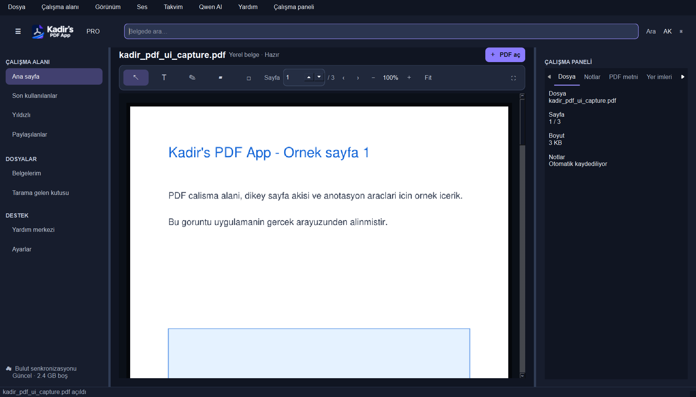
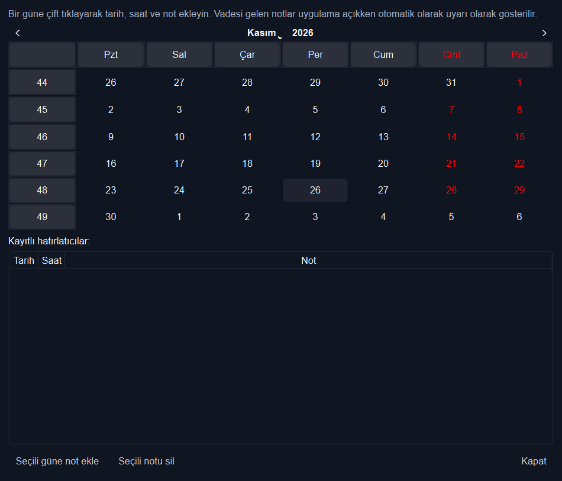
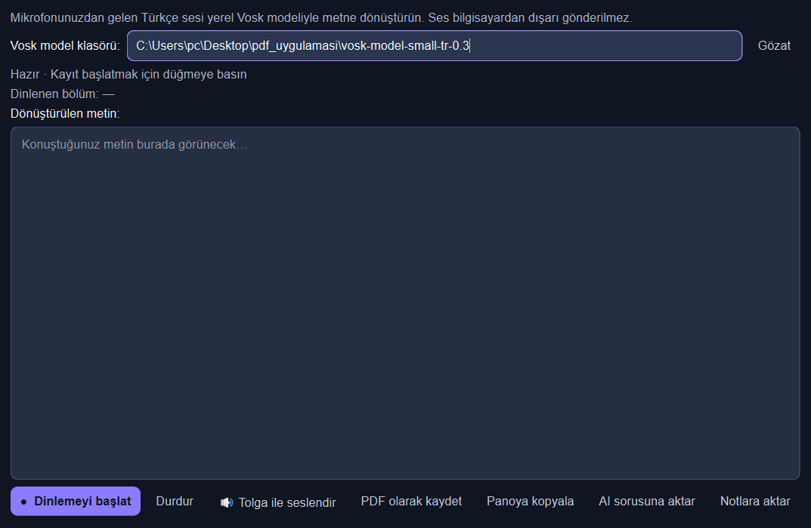
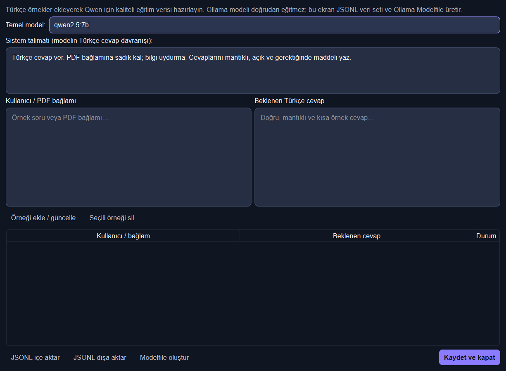
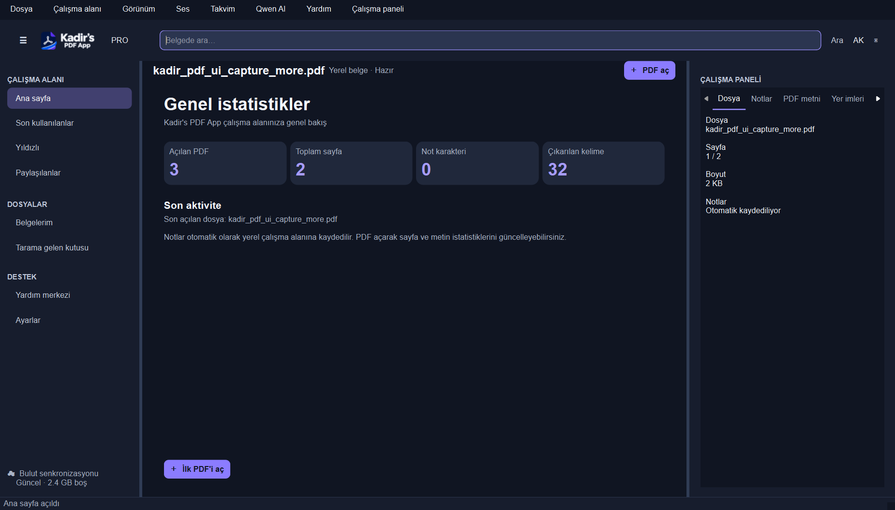
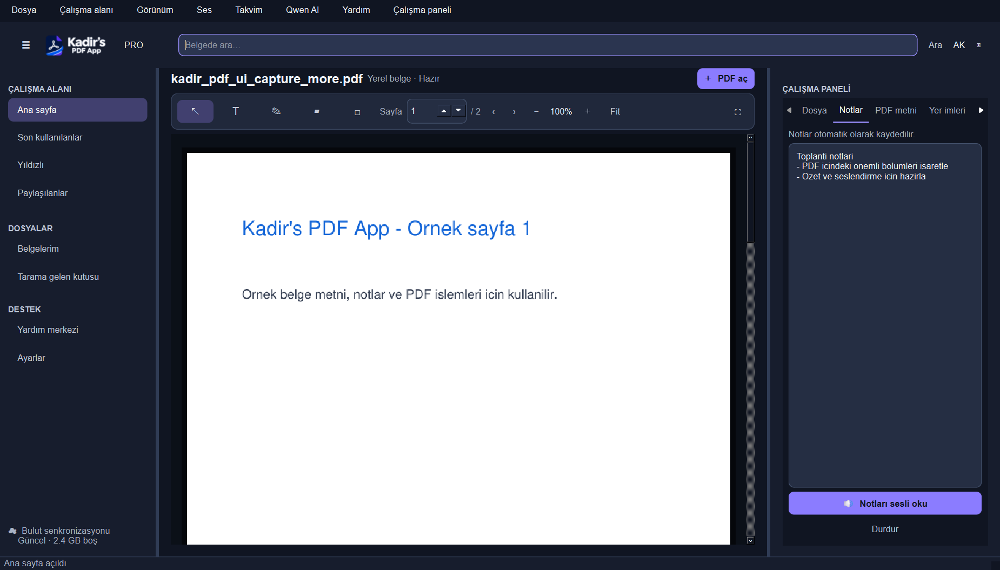
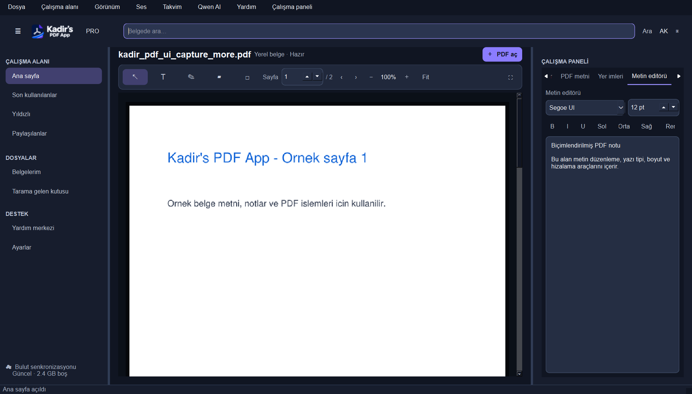
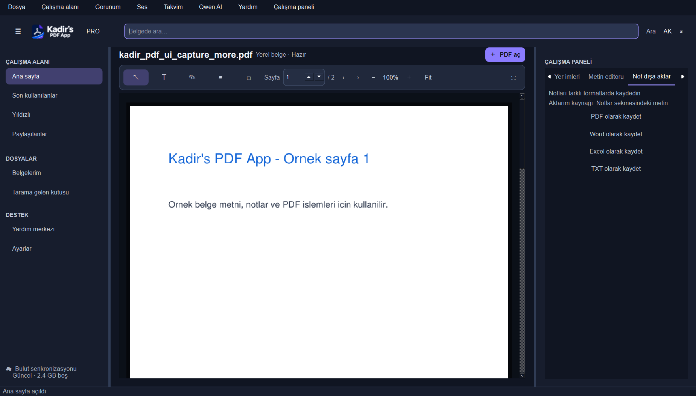
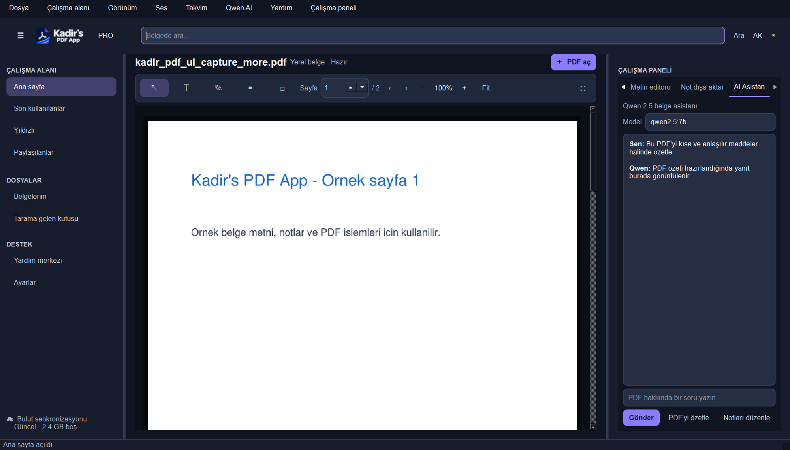

# Kadir's PDF App

## Arayuz galerisi

Asagidaki gorseller uygulamanin Windows ortaminda calistirilan orijinal arayuzunden alinmistir. Ekran goruntulerinde ornek bir PDF, takvim, Vosk sesli metin ve Qwen fine-tuning ekranlari gosterilir.

### PDF calisma alani

Tum PDF sayfalarini dikey akista goruntuleme, anotasyon araclari, yakinlastirma ve sagdaki dosya bilgileri paneli.



### Takvim ve hatirlaticilar

Takvim gorunumu, secili gun, haftalik satirlar, kayitli hatirlaticilar ve not ekleme/silme kontrolleri.



### AI, sesli metin ve seslendirme

Vosk model yolu, dinleme ve durdurma kontrolleri, Tolga ile seslendirme, PDF aktarimi ve AI/notlara aktarma secenekleri.



### Qwen fine-tuning arayuzu

Temel model, Turkce sistem talimati, kullanici/PDF baglami ve beklenen cevap alanlariyla JSONL ve Modelfile uretimi.



### Ana sayfa ve istatistikler

Ana sayfa; acilan PDF sayisi, toplam sayfa, not karakteri ve cikarilan kelime sayisini kartlar halinde gosterir. Son aktivite alani, son acilan belgeyi ve yerel kayit durumunu ozetler.



### Notlar ve seslendirme

PDF acikken notlar sag panelde otomatik kaydedilir. Notlar bu ekrandan Windows uzerindeki Tolga sesiyle okunabilir veya durdurulabilir.



### Metin editoru

Metin editoru; yazi tipi, boyut, kalin/italik/alti cizili bicimlendirme ve hizalama secenekleriyle PDF calisma alanindaki notlari duzenlemeye yardimci olur.



### Not disa aktarma

Notlar tek tikla PDF, Word, Excel veya TXT formatlarina aktarilabilir.



### AI asistani

Qwen 2.5 modeli Ollama uzerinden yerel olarak kullanilir. PDF ozeti, belge sorulari ve not duzenleme islemleri sag paneldeki AI Asistani sekmesinden yapilir.



Kadir's PDF App, Windows üzerinde çalışan, PDF belgelerini yerel olarak açmak, incelemek, düzenlemek, notlandırmak ve dışa aktarmak için geliştirilmiş bir masaüstü uygulamasıdır. Uygulama PySide6 arayüzünü, PyMuPDF belge motorunu ve isteğe bağlı olarak Ollama/Qwen yerel yapay zekâ desteğini kullanır.

## İçindekiler

- [Arayüz galerisi](#arayuz-galerisi)
- [Öne çıkan özellikler](#öne-çıkan-özellikler)
- [Gereksinimler](#gereksinimler)
- [Kurulum](#kurulum)
- [Uygulamayı çalıştırma](#uygulamayı-çalıştırma)
- [PDF görüntüleme ve gezinme](#pdf-görüntüleme-ve-gezinme)
- [Düzenleme ve anotasyon](#düzenleme-ve-anotasyon)
- [Notlar ve dışa aktarma](#notlar-ve-dışa-aktarma)
- [Vosk ile sesli metin](#vosk-ile-sesli-metin)
- [Takvim ve hatırlatıcılar](#takvim-ve-hatırlatıcılar)
- [Yerel AI asistanı](#yerel-ai-asistanı)
- [Türkçe fine-tuning hazırlığı](#türkçe-fine-tuning-hazırlığı)
- [Dil seçenekleri](#dil-seçenekleri)
- [Klavye kısayolları](#klavye-kısayolları)
- [Testler](#testler)
- [Windows EXE oluşturma](#windows-exe-oluşturma)
- [Proje yapısı](#proje-yapısı)
- [Veri saklama ve gizlilik](#veri-saklama-ve-gizlilik)
- [Sorun giderme](#sorun-giderme)

## Öne çıkan özellikler

### PDF çalışma alanı

- PDF dosyalarını dosya seçici veya `Ctrl+O` ile açma.
- Tüm PDF sayfalarını yüksek kaliteli biçimde tek bir dikey akışta görüntüleme.
- Sayfalar arasında dikey scrollbar ile gezinme.
- Sayfa numarası kutusu ve önceki/sonraki sayfa düğmeleriyle hızlı gezinme.
- Yakınlaştırma, uzaklaştırma ve `Fit` görünümü.
- Belge içinde metin arama.
- PDF’den metin çıkarma ve çıkarılan metni panoya kopyalama.
- Son kullanılan ve yıldızlanan belgeleri yerel olarak hatırlama.
- Dosya menüsünden PDF yazdırma (`Ctrl+P`).
- Yeni PDF açıldığında önceki belgenin anotasyonlarını temizleme.

### Anotasyon araçları

PDF üzerinde aşağıdaki araçlar kullanılabilir:

- Metin kutusu ekleme.
- Serbest çizim yapma.
- Vurgu alanı ekleme.
- Dikdörtgen şekil çizme.
- Son işlemi geri alma ve yineleme (`Ctrl+Z`, `Ctrl+Y`).
- Eklenen anotasyonları PDF dışa aktarımına dahil etme.

Metin anotasyonlarında yazı tipi, boyut, kalın, italik, altı çizili, hizalama ve renk seçenekleri bulunur.

### Not ve belge araçları

- Sağ panelde otomatik kaydedilen not alanı.
- Notları sesli okuma (`pyttsx3`).
- Vosk ile oluşturulan sesli metni doğrudan sistem yazıcısına gönderme.
- Notları PDF, Word, Excel veya TXT olarak kaydetme.
- Koyu, beyaz ve yumuşak açık tema seçenekleri.
- Sol ve sağ panelleri bağımsız olarak açıp kapatma.
- Tam ekran görünümü.
- Ayarlar penceresinden not otomatik kaydı ve dışa aktarma sonrası Dosya sekmesine dönüş tercihi.

## Gereksinimler

- Windows 10/11 önerilir.
- Python 3.10 veya daha yeni bir sürüm.
- PDF metni ve görüntüleme için PyMuPDF.
- Arayüz için PySide6.
- Word dışa aktarımı için `python-docx`.
- Excel dışa aktarımı için `openpyxl`.
- Sesli okuma için `pyttsx3`.
- AI özellikleri için isteğe bağlı Ollama ve Qwen modeli.

## Kurulum

PowerShell ile proje klasörüne gidin:

```powershell
cd C:\Users\pc\Desktop\pdf_uygulamasi
```

İsteğe bağlı olarak sanal ortam oluşturun:

```powershell
py -m venv .venv
.\.venv\Scripts\Activate.ps1
```

Python bağımlılıklarını kurun:

```powershell
py -m pip install --upgrade pip
py -m pip install -r requirements.txt
```

`requirements.txt` içeriği şu temel paketleri kapsar:

| Paket | Kullanım alanı |
| --- | --- |
| `PySide6` | Masaüstü arayüzü |
| `PyMuPDF` | PDF açma, render, metin çıkarma ve dışa aktarma |
| `pyttsx3` | Notları sesli okuma |
| `python-docx` | Word dışa aktarma |
| `openpyxl` | Excel dışa aktarma |
| `vosk` | İnternetsiz ses tanıma |
| `sounddevice` | Mikrofon ses akışı |
| `torch` | Qwen model eğitimi ve GPU hesaplama |
| `transformers` | Qwen tokenizer/model yükleme |
| `datasets` | JSONL veri seti okuma |
| `trl` | Supervised fine-tuning (`SFTTrainer`) |
| `peft` | LoRA/QLoRA adapter eğitimi |
| `accelerate` | Eğitim cihazı ve dağıtık çalışma yönetimi |
| `bitsandbytes` | 4-bit QLoRA quantization |
| `safetensors` | Güvenli model/adapter ağırlıkları |
| `huggingface-hub` | Hugging Face model indirme ve önbellekleme |

`requirements.txt` artık uygulama paketlerinin yanında Qwen fine-tuning paketlerini de içerir. Sadece PDF uygulamasını çalıştıracak ve eğitim yapmayacaksanız eğitim paketlerini kurmanız şart değildir; GPU ile eğitim yapacaksanız `torch` ve `bitsandbytes` sürümlerini ekran kartınıza uygun CUDA kurulumu ile doğrulayın.

## Uygulamayı çalıştırma

```powershell
py pdf_studio.py
```

Alternatif olarak:

```powershell
python pdf_studio.py
```

Uygulama açıldığında ana sayfadan `PDF aç` düğmesine basın veya `Ctrl+O` kısayolunu kullanın.

## Vosk ile sesli metin

Menü çubuğundaki `Ses > Vosk ile sesli metin` seçeneği, mikrofondan gelen Türkçe konuşmayı yerel Vosk modeliyle metne dönüştürür. Ses kaydı ve tanıma işlemi çevrimdışı yapılır; ses verisi bir sunucuya gönderilmez.

### Kurulum

Python paketleri `requirements.txt` içinde yer alır:

```powershell
py -m pip install vosk sounddevice
```

Vosk ayrıca bir dil modeli gerektirir. Resmi [Vosk model listesinden](https://alphacephei.com/vosk/models) `vosk-model-small-tr-0.3` Türkçe modelini indirin ve ZIP dosyasını açın. Önerilen klasör yapısı:

```text
pdf_uygulamasi/
└── vosk-model-small-tr-0.3/
    ├── final.mdl
    ├── ivector/
    ├── mfcc.conf
    ├── Gr.fst
    ├── HCLr.fst
    └── README
```

Model klasörü uygulamanın yanında doğrudan bulunuyorsa uygulama bunu otomatik algılar. `models/vosk-model-small-tr-0.3` alt klasöründeki kurulum da desteklenir. Model başka bir konumdaysa sesli metin penceresindeki `Gözat` düğmesiyle `final.mdl` dosyasını barındıran ana klasörü seçin. Model yolu yerel uygulama durumuna kaydedilir.

### Kullanım

1. `Ses > Vosk ile sesli metin` menüsünü açın.
2. Türkçe Vosk model klasörünü seçin.
3. `Dinlemeyi başlat` düğmesine basın.
4. Mikrofona konuşun; tamamlanan cümleler metin alanına eklenir.
5. `Durdur` ile dinlemeyi bitirin.
6. Dinleme bittiğinde metin Windows’ta kurulu `Tolga` sesiyle otomatik olarak okunur.
7. `🔊 Tolga ile seslendir` düğmesiyle metni tekrar okutun.
8. `PDF olarak kaydet` düğmesiyle sesli metni çok sayfalı PDF olarak dışa aktarın.
9. `Yazdır` düğmesiyle önce yazdırma önizlemesini açın, ardından önizleme penceresindeki yazdırma komutuyla metni Windows yazıcısına gönderin. Yazdırma işlemi için önce metin alanında içerik bulunmalıdır.
9. Metni panoya kopyalayın, AI soru alanına aktarın veya notlara ekleyin.

Tolga sesi bulunamazsa uygulama Windows’un varsayılan sesini kullanır ve durum alanında bilgi verir. Sesin Windows konuşma ayarlarında kurulu ve etkin olması gerekir. PDF dışa aktarımında Türkçe karakterler için Windows’taki `Segoe UI` veya `Arial` yazı tipi kullanılır; uzun metinler otomatik olarak birden fazla sayfaya bölünür.

Vosk’un küçük modelleri masaüstü için daha düşük bellek kullanır; daha büyük modeller doğruluğu artırabilir fakat daha fazla disk ve RAM gerektirir. Model doğruluğu mikrofon kalitesi, arka plan gürültüsü ve konuşma hızından etkilenir. [Vosk resmi model dokümantasyonu](https://alphacephei.com/vosk/models)

## Takvim ve hatırlatıcılar

Menü çubuğundaki `Takvim > Takvimi aç` seçeneği yerel bir takvim ve hatırlatıcı ekranı açar.

### Not ekleme

1. Takvimde istediğiniz güne çift tıklayın.
2. Açılan pencerede saat ve not metnini girin.
3. `Save` düğmesine basın.
4. Kayıt takvim listesinin altında görünür.

Hatırlatıcılar SQLite veritabanında saklanır:

```text
%LOCALAPPDATA%\KadirsPDFApp\calendar_reminders.sqlite3
```

Uygulama açık kaldığı sürece her 30 saniyede vadesi gelen kayıtları kontrol eder. Tarih ve saat geldiğinde Windows uygulaması içinde uyarı penceresi ve sistem uyarı sesi gösterilir. Bildirimi gösterilmiş kayıtlar tekrar tekrar uyarılmaz; takvim listesinden hangi kayıtların bildirildiği görülebilir.

`Takvim > Bugünün notlarını kontrol et` seçeneği kontrolü beklemeden manuel olarak başlatır. Seçili bir takvim kaydı `Seçili notu sil` düğmesiyle veritabanından kaldırılabilir.

Bu hatırlatıcı sistemi uygulama kapalıyken Windows arka plan servisi olarak çalışmaz. Bilgisayar veya uygulama kapalıyken gerçek işletim sistemi bildirimi isteniyorsa ayrıca Windows Task Scheduler veya bir servis entegrasyonu gerekir.

## PDF görüntüleme ve gezinme

Bir PDF açıldığında uygulama belgenin tüm sayfalarını yüksek kaliteli görüntüler olarak hazırlar ve sayfaları alt alta yerleştirir. Böylece tek tek sayfa değiştirmek zorunda kalmadan belge boyunca scrollbar ile ilerleyebilirsiniz.

Üst araç çubuğundaki kontroller:

| Kontrol | Açıklama |
| --- | --- |
| `Sayfa` | Belirli bir sayfaya gider |
| `‹` / `›` | Önceki veya sonraki sayfaya geçer |
| `−` / `＋` | Görüntüyü küçültür veya büyütür |
| `Fit` | Görüntüleme ölçeğini varsayılan görünüme getirir |
| `⛶` | Tam ekran modunu açar veya kapatır |

Render kalitesi, PDF’nin temel 72 DPI koordinatlarının ekranlarda daha net görünmesi için iyileştirilmiş ölçekle hazırlanır. Çok büyük sayfalarda bellek kullanımını dengede tutmak için sayfa başına güvenli piksel sınırı uygulanır.

## Düzenleme ve anotasyon

Araç çubuğundan bir araç seçin ve PDF sayfası üzerinde işlem yapın:

1. `T` ile metin aracını seçin ve sayfaya tıklayın.
2. `✎` ile serbest çizim yapın.
3. `▰` ile vurgulamak istediğiniz alanı sürükleyin.
4. `□` ile dikdörtgen şekil çizin.
5. `Ctrl+Z` ile geri alın, `Ctrl+Y` ile yineleyin.

Birden fazla sayfa açıkken eklenen anotasyonlar sayfa numarasıyla ilişkilendirilir. PDF dışa aktarılırken anotasyonlar eklendikleri sayfaya yazılır.

## Notlar ve dışa aktarma

Sağ paneldeki `Notlar` sekmesine yazılan içerik uygulamanın yerel durum dosyasına otomatik olarak kaydedilir. Notlar aşağıdaki formatlarda dışa aktarılabilir:

- PDF
- Word (`.docx`)
- Excel (`.xlsx`)
- Düz metin (`.txt`)

PDF üzerindeki anotasyonları dışa aktarmak için `Dosya > PDF dışa aktar` veya `Ctrl+S` kullanılır. Kaynak dosyanın üzerine yazılması istenirse uygulama geçici bir dosya kullanarak güvenli şekilde değiştirme yapar.

## Yerel AI asistanı

AI özellikleri internete PDF göndermeden, bilgisayarda çalışan Ollama servisi üzerinden kullanılabilir. Varsayılan model `qwen2.5:7b` olarak ayarlanmıştır.

### Ollama kurulumu

Ollama kurulduktan sonra bir PowerShell penceresinde şu komutları çalıştırın:

```powershell
ollama serve
ollama pull qwen2.5:7b
```

Uygulama başlangıçta Ollama’yı kontrol eder. Servis çalışmıyorsa başlatmayı dener; model kurulu değilse model indirme işlemini başlatır. İlk model indirmesi birkaç GB boyutunda olabilir.

### AI sekmesini kullanma

`AI Asistan` sekmesinden:

- PDF hakkında soru sorabilirsiniz.
- `PDF’yi özetle` düğmesiyle kısa ve anlaşılır madde özeti alabilirsiniz.
- `Notları düzenle` düğmesiyle mevcut notları düzenletebilirsiniz.
- Ollama’da kurulu farklı bir model varsa model alanını değiştirebilirsiniz.

Yanıtlar akışlı olarak alınır; bu nedenle model uzun bir belgeyi işlerken uygulama yanıt gelene kadar donmaz. AI bağlamı performans için PDF metninin ilk 14.000 karakteri ve notların ilk 5.000 karakteriyle sınırlandırılır.

### AI sorunları

`AI isteği başarısız` mesajı görülürse:

```powershell
ollama list
```

komutuyla modelin kurulu olduğunu kontrol edin. Gerekirse:

```powershell
ollama pull qwen2.5:7b
```

komutunu yeniden çalıştırın. Büyük PDF’lerde özetleme uzun sürebileceğinden, kısa bir metinle veya daha küçük bir belgeyle tekrar deneyin.

## Türkçe fine-tuning hazırlığı

Menü çubuğundaki `Qwen AI > Türkçe fine-tuning hazırlığı` bölümü, Qwen 2.5’in Türkçe ve belge odaklı cevap davranışını geliştirmek için örnek veri hazırlamaya yarar.

### Arayüzde yapılabilenler

- Türkçe sistem talimatı tanımlama.
- Kullanıcı sorusu veya PDF bağlamı ekleme.
- Beklenen kaliteli Türkçe cevabı ekleme.
- Örnekleri tablo üzerinden düzenleme ve silme.
- Mevcut JSONL veri setini içe aktarma.
- Qwen uyumlu JSONL eğitim verisi dışa aktarma.
- Örnekleri içeren bir Ollama `Modelfile` üretme.
- Kullanılacak temel model adını değiştirme.

### Örnek hazırlama önerisi

Kaliteli veri için her örnekte şu üç unsur bulunmalıdır:

1. Gerçek bir kullanıcı sorusu veya PDF’den alınmış kısa bağlam.
2. Soruyla doğrudan ilişkili, doğrulanabilir bilgi.
3. Türkçe, açık, mantıklı ve gereksiz tekrar içermeyen beklenen cevap.

Örnekler tutarlı olmalıdır. Aynı soruya farklı ve çelişkili cevaplar eklemek modelin davranışını kötüleştirebilir. Başlangıç için farklı görev türlerinden en az 20–50 temiz örnek hazırlanması, daha iyi sonuç için ise yüzlerce dengeli örnek kullanılması önerilir.

### JSONL çıktısı

Uygulama aşağıdaki konuşma formatında bir kayıt üretir:

```json
{"messages":[{"role":"system","content":"Türkçe cevap ver ve PDF bağlamına sadık kal."},{"role":"user","content":"Bu belgeyi üç maddede özetle."},{"role":"assistant","content":"- Belgenin ana konusu...\n- Önemli bulgu...\n- Sonuç..."}]}
```

Bu dosya, Unsloth, Axolotl, TRL veya benzeri bir eğitim aracıyla LoRA/QLoRA veri seti olarak kullanılabilir. Eğitim aracının istediği özel alan adları varsa JSONL dönüşümü gerekebilir.

### Ollama Modelfile çıktısı

`Modelfile oluştur` düğmesi, mevcut Qwen modelinden türetilen ve Türkçe sistem talimatlarını içeren bir Ollama yapılandırması üretir. Oluşturulan dosyayı kullanmak için PowerShell’de:

```powershell
ollama create qwen-turkish-pdf -f Modelfile.qwen-tr
ollama run qwen-turkish-pdf
```

Bu işlem gerçek ağırlık fine-tuning’i değildir; sistem talimatı ve örnek konuşmalarla davranış yönlendirmesi sağlar. Gerçek LoRA/QLoRA fine-tuning için GPU, eğitim kütüphanesi, tokenizer ve ayrıca hazırlanmış bir eğitim süreci gerekir. Uygulama bu dış eğitim sürecini otomatik olarak başlatmaz; veri hazırlama ve Ollama yapılandırması üretme işini yapar.

Kaydedilen sistem talimatı, uygulamanın normal `AI Asistan` isteklerinde de kullanılır. Böylece hazırlık ekranında belirlediğiniz Türkçe cevap kuralları, eğitim verisi dışa aktarılmadan da yerel asistan yanıtlarına uygulanabilir.

### Gerçek LoRA/QLoRA fine-tuning adımları

Uygulamadaki arayüz veri hazırlama aşamasını kolaylaştırır; model ağırlıklarını eğitmek için ayrı bir eğitim ortamı gerekir. Önerilen işlem sırası şöyledir:

```text
PDF Studio arayüzü
        ↓
JSONL konuşma veri seti
        ↓
QLoRA / LoRA ile SFT eğitimi
        ↓
Safetensors adapter veya birleştirilmiş model
        ↓
Ollama / GGUF ile yerel kullanım
```

#### 1. Veri setini hazırlayın

1. Uygulamada `Qwen AI > Türkçe fine-tuning hazırlığı` menüsünü açın.
2. Sistem talimatını belirleyin. Örneğin: “Yalnızca verilen PDF bağlamını kullan; emin olmadığın bilgiyi uydurma; cevapları Türkçe ve maddeli ver.”
3. Farklı görev türlerinden örnekler ekleyin: özetleme, ana fikir çıkarma, tablo açıklama, soru-cevap, karşılaştırma ve kaynak metne sadık cevap.
4. Her örneğin beklenen cevabını insan tarafından kontrol edin.
5. `JSONL dışa aktar` ile `qwen_turkish_dataset.jsonl` dosyasını kaydedin.

İyi veri, yalnızca çok sayıda veri değildir. Çelişkili, yazım hatalı veya modelin öğrenmesini istemediğiniz cevapları veri setine koymayın. Aynı formatı koruyun ve veri setinin küçük bir bölümünü doğrulama için ayırın. TRL’nin SFTTrainer bileşeni `messages` alanını kullanan konuşma veri setlerini doğrudan destekler ve chat template’i uygular: [TRL SFTTrainer veri formatı](https://huggingface.co/docs/trl/sft_trainer).

#### 2. Eğitim ortamını hazırlayın

Qwen 2.5 7B modelini eğitmek için CUDA destekli NVIDIA GPU ve yeterli VRAM gerekir. Windows’ta en sorunsuz yol çoğunlukla WSL2/Ubuntu veya Linux kullanmaktır; CPU ile 7B eğitim pratik değildir. GPU belleğiniz sınırlıysa `Qwen/Qwen2.5-1.5B-Instruct` gibi daha küçük bir modelle başlayın.

Yeni bir Python ortamında, eğitim makinesinde:

```bash
python -m venv .venv
source .venv/bin/activate
python -m pip install --upgrade pip
pip install torch transformers datasets trl peft accelerate bitsandbytes
```

Windows PowerShell’de sanal ortamı etkinleştirme karşılığı:

```powershell
python -m venv .venv
.\.venv\Scripts\Activate.ps1
python -m pip install --upgrade pip
pip install torch transformers datasets trl peft accelerate bitsandbytes
```

`bitsandbytes` ve CUDA uyumluluğu işletim sistemi, ekran kartı sürücüsü ve PyTorch sürümüne bağlıdır. Kurulumdan sonra kontrol edin:

```bash
python -c "import torch; print(torch.cuda.is_available()); print(torch.cuda.get_device_name(0) if torch.cuda.is_available() else 'CUDA yok')"
```

Çıktı `True` değilse eğitime başlamadan önce NVIDIA sürücüsü, CUDA uyumlu PyTorch paketi ve `bitsandbytes` kurulumunu düzeltin.

#### 3. QLoRA ile SFT eğitimi

Aşağıdaki örnek, Hugging Face Qwen2.5-Instruct modeli üzerinde 4-bit QLoRA ve TRL `SFTTrainer` kullanır. Bu yöntem temel modelin bütün ağırlıklarını değiştirmek yerine küçük bir LoRA adapter’ı eğitir; disk ve VRAM ihtiyacı tam fine-tuning’e göre daha düşüktür.

`train_qwen.py` adıyla kaydedin:

```python
import torch
from datasets import load_dataset
from peft import LoraConfig
from transformers import AutoModelForCausalLM, AutoTokenizer, BitsAndBytesConfig
from trl import SFTConfig, SFTTrainer

BASE_MODEL = "Qwen/Qwen2.5-7B-Instruct"
DATASET = "qwen_turkish_dataset.jsonl"
OUTPUT_DIR = "qwen-turkish-pdf-lora"

dataset = load_dataset("json", data_files=DATASET, split="train")
tokenizer = AutoTokenizer.from_pretrained(BASE_MODEL, use_fast=True)
if tokenizer.pad_token is None:
    tokenizer.pad_token = tokenizer.eos_token

quantization = BitsAndBytesConfig(
    load_in_4bit=True,
    bnb_4bit_quant_type="nf4",
    bnb_4bit_compute_dtype=torch.bfloat16,
    bnb_4bit_use_double_quant=True,
)

model = AutoModelForCausalLM.from_pretrained(
    BASE_MODEL,
    quantization_config=quantization,
    device_map="auto",
    torch_dtype=torch.bfloat16,
)
model.config.use_cache = False

lora = LoraConfig(
    r=16,
    lora_alpha=32,
    lora_dropout=0.05,
    bias="none",
    task_type="CAUSAL_LM",
    target_modules=["q_proj", "k_proj", "v_proj", "o_proj", "gate_proj", "up_proj", "down_proj"],
)

training = SFTConfig(
    output_dir=OUTPUT_DIR,
    num_train_epochs=2,
    per_device_train_batch_size=1,
    gradient_accumulation_steps=8,
    learning_rate=2e-4,
    logging_steps=5,
    save_strategy="epoch",
    max_length=2048,
    packing=False,
    report_to="none",
)

trainer = SFTTrainer(
    model=model,
    processing_class=tokenizer,
    train_dataset=dataset,
    args=training,
    peft_config=lora,
)
trainer.train()
trainer.save_model(OUTPUT_DIR)
tokenizer.save_pretrained(OUTPUT_DIR)
```

Çalıştırın:

```bash
python train_qwen.py
```

Notlar:

- `BASE_MODEL`, uygulamadaki Ollama etiketi olan `qwen2.5:7b` ile aynı dosya değildir; eğitim Hugging Face model klasörü üzerinden yapılır.
- Eğitimden önce Qwen modelinin lisansını, veri setindeki kişisel/telifli bilgileri ve dağıtım koşullarını kontrol edin.
- `num_train_epochs=2` ve `learning_rate=2e-4` başlangıç değerleridir; küçük veri setlerinde aşırı öğrenme görülebilir.
- Kayıp düşerken cevap kalitesi bozuluyorsa epoch sayısını veya learning rate değerini azaltın.
- Eğitim sırasında GPU belleği yetmezse `max_length`, `gradient_accumulation_steps` veya model boyutunu azaltın.
- TRL sürümüne göre `max_length`/`max_seq_length` ve `processing_class`/`tokenizer` isimleri değişebilir; kurulu sürümün resmi dokümantasyonunu kontrol edin.

Unsloth, aynı işi daha az VRAM ve daha yüksek eğitim hızı hedefiyle kolaylaştıran alternatif bir eğitim katmanıdır. Unsloth’un güncel QLoRA/LoRA rehberi: [Fine-tuning LLMs Guide](https://unsloth.ai/docs/get-started/fine-tuning-llms-guide).

#### 4. Adapter’ı değerlendirin

Eğitim verisindeki örnekleri sadece tekrar sormak yeterli değildir. Ayrı tuttuğunuz doğrulama sorularını, eğitim öncesi ve sonrası aynı ayarlarla test edin:

- Türkçe dilbilgisi ve anlam bütünlüğü.
- PDF bağlamına sadakat.
- Bilgi uydurma oranı.
- Özetlerin istenen uzunlukta olması.
- Aynı soruya verilen cevapların tutarlılığı.

Eğitim verisindeki tüm örneklerde mükemmel, yeni sorularda zayıf cevaplar görülüyorsa model aşırı öğrenmiş olabilir. Bu durumda daha çeşitli veri, daha az epoch veya daha düşük learning rate deneyin.

#### 5. Adapter’ı Ollama’ya aktarma

Eğitim sonunda `qwen-turkish-pdf-lora` klasöründe Safetensors adapter oluşur. Ollama’da adapter kullanımı sürüme ve model mimarisine bağlıdır. Sürümünüz `ADAPTER` yönergesini destekliyorsa `FROM` ile belirtilen temel model, adapter’ın eğitildiği temel modelle aynı olmalıdır. Örnek yapı şöyledir:

```text
FROM <adapter-egitilen-temel-model>
ADAPTER /tam/yol/qwen-turkish-pdf-lora
PARAMETER temperature 0.2
```

Bu dosyayı `Modelfile.adapter` adıyla kaydedin ve:

```powershell
ollama create qwen-turkish-pdf -f Modelfile.adapter
ollama run qwen-turkish-pdf
```

Ollama’nın adapter ve Safetensors desteği model mimarisine ve kullanılan Ollama sürümüne bağlıdır. Güncel resmi belgeler Safetensors model klasörünü ve GGUF modelini içe aktarma yollarını açıklar; adapter yönergesi görünmüyorsa adapter’ı temel modelle birleştirip GGUF olarak içe aktarmak daha güvenli yoldur: [Ollama model içe aktarma](https://docs.ollama.com/import).

Qwen adapter’ı kullandığınız Ollama sürümünde doğrudan çalışmazsa iki alternatif vardır:

1. Adapter’ı eğitim kütüphanesiyle temel modele merge edin, ardından birleşmiş Hugging Face modeli GGUF’a dönüştürün.
2. Oluşan GGUF dosyasını Modelfile içinde doğrudan `FROM C:\\modeller\\qwen-turkish-pdf.gguf` ile gösterip `ollama create` çalıştırın.

GGUF dönüşümünde temel model/adapter uyumluluğunu ve Qwen mimarisi için kullanılan llama.cpp dönüşüm aracının güncel talimatlarını kontrol edin. Yanlış temel modelle adapter birleştirmek hatalı veya anlamsız cevaplara yol açabilir.

#### 6. Bu uygulamada kullanma

Ollama’da yeni model oluştuğunda uygulamanın `AI Asistan` sekmesindeki `Model` alanına şu etiketi yazın:

```text
qwen-turkish-pdf
```

Uygulama `http://127.0.0.1:11434/api/generate` adresine istek gönderir. Ollama servisini başlatın, sonra uygulamayı açın:

```powershell
ollama serve
py pdf_studio.py
```

Uygulama içindeki fine-tuning ekranında belirlenen sistem talimatı ve en fazla sekiz örnek, normal AI isteklerinde de few-shot bağlam olarak kullanılır. Bu davranış gerçek ağırlık eğitiminin yerine geçmez; fine-tuned model ile prompt tabanlı yönlendirmeyi birlikte test etmek için kullanılır.

## Klavye kısayolları

| Kısayol | İşlem |
| --- | --- |
| `Ctrl+O` | PDF aç |
| `Ctrl+F` | Belge arama alanına odaklan |
| `Ctrl+S` | PDF dışa aktar |
| `Ctrl+P` | PDF yazdır |
| `Ctrl+Z` | Anotasyonu geri al |
| `Ctrl+Y` | Anotasyonu yinele |
| `Escape` | Seçim aracına dön |
| `F11` | Tam ekranı aç/kapat |
| `Alt+F4` | Uygulamayı kapat |

## Testler

Testleri Ollama başlatmadan çalıştırmak için:

```powershell
$env:QT_QPA_PLATFORM = "offscreen"
$env:PDF_STUDIO_TEST_MODE = "1"
py -m unittest -v test_pdf_studio.py
```

Test paketi şu alanları doğrular:

- Ana menülerin oluşturulması.
- Tema değiştirme.
- Sol ve sağ panel görünürlüğü.
- Dashboard istatistikleri.
- Yıldızlama ve dosya yolu paylaşımı.
- AI yanıtlarının güvenli HTML gösterimi.
- PDF not dışa aktarımı.
- Anotasyon geri alma/yineleme.
- PDF araması.
- Anotasyonların dışa aktarılan PDF’ye yazılması.
- Büyük metinlerde render sınırının uygulanması.

## Windows EXE oluşturma

PyInstaller’ı kurun:

```powershell
py -m pip install pyinstaller
```

Tek dosyalık Windows uygulaması oluşturun:

```powershell
pyinstaller --noconfirm --onefile --windowed `
  --name "KadirsPDFApp" `
  --icon "kadir_pdf_logo.ico" `
  --add-data "kadir_pdf_logo.png;." `
  --add-data "kadir_pdf_logo.ico;." `
  pdf_studio.py
```

Oluşan dosya genellikle `dist\KadirsPDFApp.exe` konumunda bulunur. PyInstaller ile oluşturulan EXE, Python paketlerini içerir; Ollama ve Qwen modeli ise ayrı kurulmalıdır.

### Hazır Windows sürümü

ICO simgesi EXE içine gömülmüş hazır Windows sürümünü [v1.1.1 release sayfasından](https://github.com/kadir905/kadir_s_pdf_app_2026/releases/tag/v1.1.1) indirebilirsiniz. `KadirsPDFApp.exe` tek dosyalı dağıtımdır; Vosk Türkçe model klasörü ve Ollama/Qwen kurulumu uygulamadan ayrı tutulur.

## Proje yapısı

```text
pdf_uygulamasi/
├── pdf_studio.py          # Ana PySide6 uygulaması
├── test_pdf_studio.py     # Birim ve arayüz testleri
├── requirements.txt       # Python bağımlılıkları
├── kadir_pdf_logo.png     # Uygulama logosu
├── kadir_pdf_logo.ico     # Windows uygulama simgesi
├── KadirsPDFApp.spec      # PyInstaller yapılandırması
├── README.md              # Proje dokümantasyonu
├── docs/screenshots/      # Orijinal uygulama arayüzü ekran görüntüleri
├── build/                 # PyInstaller geçici çıktı klasörü
└── dist/                  # Dağıtılabilir EXE çıktısı
```

### Ana bileşenler

- `OllamaWorker`: AI isteklerini arka planda çalıştırır ve akışlı yanıtları toplar.
- `OllamaSetupWorker`: Ollama servisini ve Qwen modelini kontrol eder.
- `SpeechWorker`: Notları kullanıcı arayüzünü kilitlemeden seslendirir.
- `PageCanvas`: PDF sayfalarını yüksek kaliteli, dikey ve scrollbar uyumlu biçimde çizer.
- `PDFStudio`: Ana pencereyi, menüleri, panelleri, PDF işlemlerini ve dışa aktarmayı yönetir.

## Veri saklama ve gizlilik

Uygulama yerel çalışma mantığıyla tasarlanmıştır. Son kullanılan dosyalar, yıldızlanan dosyalar ve notlar durum dosyasında saklanır:

```text
%LOCALAPPDATA%\KadirsPDFApp\pdf_studio_state.json
```

`LOCALAPPDATA` kullanılamıyorsa uygulama klasörü altında `user_data` klasörü kullanılır. PDF dosyalarının kendisi otomatik olarak başka bir sunucuya yüklenmez. AI kullanıldığında metin, bilgisayardaki yerel Ollama servisine (`127.0.0.1:11434`) gönderilir.

## Sorun giderme

### Uygulama açılmıyor

Python ve bağımlılıkları kontrol edin:

```powershell
py --version
py -m pip install -r requirements.txt
```

### PDF görüntülenmiyor

PyMuPDF’nin kurulu olduğunu kontrol edin:

```powershell
py -m pip install --upgrade PyMuPDF
```

### PDF metni boş görünüyor

Belge taranmış görüntü tabanlı bir PDF olabilir. Bu uygulamanın metin çıkarma özelliği OCR yapmaz; bu tür belgelerde önce OCR uygulanmış bir PDF oluşturulmalıdır.

### Seslendirme çalışmıyor

`pyttsx3` paketini yeniden kurun ve Windows’ta uygun bir konuşma sesi bulunduğunu kontrol edin:

```powershell
py -m pip install --upgrade pyttsx3
```

### Dışa aktarma seçenekleri çalışmıyor

İlgili paketleri kurun:

```powershell
py -m pip install --upgrade PyMuPDF python-docx openpyxl
```

### Ollama bulunamıyor

Ollama’nın PATH’e eklendiğini ve servisin çalıştığını kontrol edin:

```powershell
ollama list
```

Komut bulunamıyorsa Ollama’yı kurun veya yeni bir PowerShell penceresi açarak PATH’in güncellenmesini sağlayın.

## Lisans ve geliştirme notu

Bu proje yerel PDF çalışma alanı olarak geliştirilmiştir. Üretim dağıtımından önce bağımlılık lisanslarının, dağıtım boyutunun ve Ollama/Qwen model lisansının ayrıca incelenmesi önerilir.

## Dil seçenekleri

Uygulama menüsündeki **Dil / Language** bölümünden **Türkçe**, **English** veya **Español** seçilebilir. Seçim anında menüler, sekmeler, gezinme düğmeleri, dashboard kartları ve yaygın işlem metinleri güncellenir. Seçilen dil yerel durum dosyasına kaydedilir ve uygulama yeniden açıldığında korunur. PDF içeriği, dosya adları ve kullanıcı notları değiştirilmez.

## Güvenlik ve doğrulama

Uygulama kullanıcı ve Ollama kaynaklı metinleri arayüzde HTML olarak güvenli biçimde kaçışlar; böylece AI sohbet alanında HTML/JavaScript enjeksiyonu engellenir. Ollama ve Vosk işlemleri sabit komut argümanlarıyla, kabuk açılmadan çalıştırılır. PDF dışa aktarma ve durum dosyası işlemleri yalnızca kullanıcının seçtiği yerel yolları kullanır.

Kod değişikliklerinden sonra aşağıdaki kontroller uygulanır:

```powershell
$env:QT_QPA_PLATFORM = "offscreen"
$env:PDF_STUDIO_TEST_MODE = "1"
py -m unittest discover -v
py -m compileall -q pdf_studio.py test_pdf_studio.py
py -m pip check
py -m pip_audit -r requirements.txt
```

Son güvenlik taramasında bilinen bağımlılık açığı bulunmamıştır. GPU fine-tuning paketleri yalnızca eğitim yapılacak ortamda kurulmalı ve güvenilir kaynaklardan yüklenmelidir.

## Google Drive senkronizasyonu

Uygulama menüsündeki **Google Drive > Senkronizasyon panelini aç** seçeneğiyle açılan panel; açık PDF'yi, notları ve uygulama durumunu Drive'a yükleyebilir, Drive kök klasöründeki PDF'lerden birini seçip bilgisayara indirebilir.

### Google Cloud yapılandırması

1. [Google Cloud Console](https://console.cloud.google.com/) üzerinden bir proje oluşturun veya mevcut projeyi seçin.
2. **Google Drive API**'yi etkinleştirin.
3. **APIs & Services > Credentials > Create credentials > OAuth client ID** yolundan **Desktop app** türünde istemci oluşturun.
4. İndirilen OAuth JSON dosyasını uygulama klasörüne `client_secret.json` adıyla koyun veya paneldeki **OAuth JSON seç** düğmesiyle gösterin.
5. **Google hesabına bağlan** düğmesine basın. İlk kullanımda tarayıcıda Google izin ekranı açılır; yenileme token'ı `%LOCALAPPDATA%\\KadirsPDFApp\\google_drive_token.json` konumunda yerel olarak saklanır.

Uygulama yalnızca en az yetkili `drive.file` kapsamını ister. OAuth JSON ve token dosyalarını GitHub'a yüklemeyin. Erişimi kaldırmak için Google hesabınızdaki üçüncü taraf uygulama izinlerini iptal edebilir veya yerel token dosyasını silebilirsiniz.

## English

Kadir's PDF App is a local Windows desktop application for opening, reading, annotating, exporting and printing PDF documents. The interface can be switched at runtime between Turkish, English and Spanish from the **Language / Dil** menu. The selected language is saved locally and restored on the next launch.

### Main features

- Vertical PDF page viewer with high-quality RGB rendering, zoom controls and scrollbar navigation.
- Text, drawing, highlight and shape annotations with undo/redo support.
- Notes that can be saved as PDF, Word, Excel or TXT, printed, copied and read aloud with the Windows voice engine.
- Local Vosk speech-to-text support using `vosk-model-small-tr-0.3`.
- Local Ollama/Qwen 2.5 assistant for summaries, document questions and note cleanup.
- Qwen fine-tuning preparation screen that exports JSONL training data and an Ollama Modelfile.
- Calendar reminders stored in a local SQLite database and shown while the application is running.
- Optional Google Drive synchronization with least-privilege `drive.file` OAuth: upload the open PDF, notes and local state, or download a PDF.
- Search, starred documents, recent files, themes, full-screen mode and a Windows EXE distribution with the application ICO embedded.

### Language selection

Open **Language / Dil** in the application menu and choose **Türkçe**, **English** or **Español**. Menu labels, navigation buttons, dashboard cards, tabs and common application controls are refreshed immediately. PDF content, filenames and user-created notes are intentionally kept unchanged.

### English setup

```powershell
py -m pip install -r requirements.txt
py pdf_studio.py
```

For the AI assistant, install Ollama and pull a compatible Qwen model such as `qwen2.5:7b`. For speech recognition, keep the `vosk-model-small-tr-0.3` folder next to the application or inside the `models` folder. The ready-to-use Windows build is available from the [v1.1.1 release](https://github.com/kadir905/kadir_s_pdf_app_2026/releases/tag/v1.1.1).

For Google Drive sync, enable the Google Drive API in Google Cloud Console, create a Desktop OAuth client, download its JSON file, and select it in **Google Drive > Open sync panel**. The app requests only the `drive.file` scope and stores the refresh token locally under `%LOCALAPPDATA%\\KadirsPDFApp`; never commit either JSON credentials or token files.

### English EXE build

```powershell
py -m pip install pyinstaller
pyinstaller --noconfirm --clean KadirsPDFApp.spec
```

The generated file is `dist\\KadirsPDFApp.exe`. The ICO file is embedded through `KadirsPDFApp.spec`; Ollama, the Qwen model and the Vosk model remain separate runtime resources.
